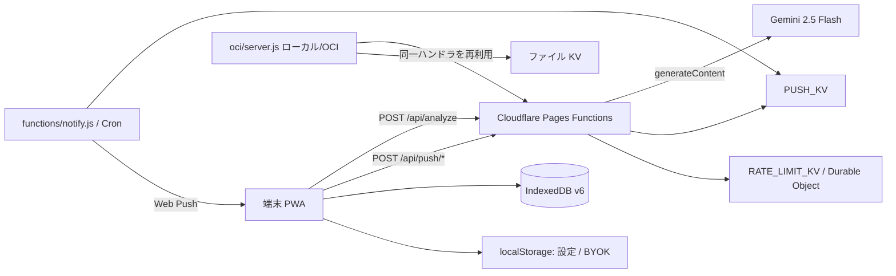

# アーキテクチャマップ（Round 4 更新版）

> 詳細は `01_要件定義書_機能仕様書.md`〜`03_プログラム設計書_詳細設計書.md`。このファイルは実装の現在地を記録する。スキャン結果で更新する。

## システム境界



## ランタイムと技術方式

| 領域 | 方式 | 根拠 |
|---|---|---|
| 静的配信 | `public/` + Service Worker（network-first / api は network-only） | `public/sw.js` |
| フロントコントローラ | `public/js/app.js`（イベント配線 + UI 描画） | `app.js` |
| 純粋ロジック | `dates.js`, `inventory.js`, `features2.js`, `learning.js`, `history.js`, `queue.js` | 各ファイル |
| 永続化 | IndexedDB v6（`db.js`） | `db.js` |
| 設定 | `localStorage`（`settings.js`） | `settings.js` |
| API プロキシ | Pages Functions `functions/api/*` | `functions/api/analyze.js` 他 |
| ローカル/OCI | `oci/server.js` が Functions ハンドラを再利用 | `oci/server.js` |
| レート制限 | Durable Object → KV → メモリ / OCI はファイル KV | `ratelimit-worker/`, `functions/shared/limits.js` |
| 通知 | `functions/shared/webpush.js` + `functions/notify.js` | `wrangler.notify.toml`, `functions/api/push/*` |

## 状態の所有権（暫定）

| 状態 | 権威 | 主な読み書き |
|---|---|---|
| 在庫・履歴・学習・キュー・買い物リスト | IndexedDB v6 | `db.js` 経由で `app.js` / `settings.js` |
| テーマ・通知設定・BYOK・広告同意 | localStorage | `settings.js` |
| 選択モード・検索・フィルタ・プレビュー画像 | `app.js` の `state` | `app.js` / `calendarUI.js` / `queueUI.js` |
| Push 購読・次回期限 | `PUSH_KV` | `functions/api/push/*` / `functions/notify.js` |

## 既知の単一情報源

- 日付検証・書式・残日数: `public/js/dates.js`（Round 0 前に集約済み）
- E2E の初期化: `e2e/helpers.js`（Round 0 前に集約済み）
- 通知時刻判定: `functions/shared/schedule.js`（ADR-003）
- レート制限ポリシー: `functions/shared/limits.js`（ADR-004）
- 通知ハンドラ: `functions/notify.js`（Round 4 で旧 Worker を削除）
- 強制: `tests/architecture.test.js` がレイヤー逆転と二重定義を `npm test` で検出（ADR-005）

## スキャンで更新するセクション

- 完全な import / export 依存グラフと循環の有無
- 定数・列挙・設定キーの定義箇所一覧
- 重複実装一覧と Deletion Test の結果
- 規範逸脱一覧と CI 強制のギャップ

## サーバー側マップ（ServerMap 成果）

### エンドポイントと契約

| 経路 | 契約 | 根拠 |
|---|---|---|
| `POST /api/analyze` | in: `imageBase64`, `mimeType`, `clientDate`, `customApiKey` / out: `{purchaseDate, items[]}` / err: 400, 413, 422, 429, 500, 502, 503 | `functions/api/analyze.js:242-338` |
| `POST /api/validate-key` | in: `apiKey` / out `{ok:true}` / 400, 413, 429, 502, 503 | `functions/api/validate-key.js:31-68` |
| `POST /api/metrics` | in `kind`,`count`（count は無視し常に +1） | `functions/api/metrics.js:5-25` |
| `GET /api/config` | `{supportUrl, adsenseClient, adsenseSlot}` | `functions/api/config.js:1-9` |
| `GET /api/push/config` | `{publicKey}` | `functions/api/push/config.js:1-5` |
| `POST /api/push/subscribe` | in `subscription`,`nextExpiry`,`expiryDates`,`daysUntil`,`notifyHour` | `functions/api/push/subscribe.js:51-147` |
| `POST /api/push/unsubscribe` | in `endpoint` | `functions/api/push/unsubscribe.js:6-17` |

### バインディングとランタイム差

- Pages: `RATE_LIMIT_KV` / `PUSH_KV` (`wrangler.toml:5-11`)、`RATE_LIMITER_DO` (`14-17`)、VAPID 公開鍵・Adsense は vars (`19-23`)。production 定義が重複 (`27-45`)。
- 通知: `wrangler.notify.toml` の `functions/notify.js`（毎分・Web Crypto 実装・`listLimit=200`・JST 時刻判定は `functions/shared/schedule.js`）。旧 `notify-worker/` は Round 4 で削除。
- レート制限: DO → KV → メモリの階層は CF / OCI / ローカルの差に対応する意図的設計（`analyze.js:110-165`）。`ratelimit-worker/wrangler.toml:5-7` の自己バインディングは未使用。
- OCI: `apiEnv()` が同一ハンドラへ env を注入 (`oci/server.js:43-55`)、KV はファイル永続化 (`oci/kv-adapter.js`)、`REMINDERS_ENABLED` で Cron と二重送信を回避 (`server.js:192-205`)。

### 横断的な重複（要 Deletion Test）

| 概念 | 重複箇所 | 判定 |
|---|---|---|
| `jstDate` / `shouldSendAtHour` | Round 1 で `functions/shared/schedule.js` に一本化。`public/js/features2.js` の定義は削除済み | 解決（ADR-003） |
| 通知時刻の再送抑止 | `schedule.js:18` が同一 JST 日・同一時刻の再実行を抑止。`sendReminders` 経由の実経路テストを追加 | 解決（Round 1） |
| レート制限ポリシー | Round 2 で `functions/shared/limits.js` に一本化。解析 DO / Pages / OCI / 購読 / キー検証が同一値を参照 | 解決（ADR-004） |
| 通知ハンドラ | Round 4 で `notify-worker/` を削除し `functions/notify.js` に統一 | 解決（Round 4） |
| `daysUntilDate` | `reminder.js:22-24`, `subscribe.js:47-48`, `dates.js:28-35` | 後者はローカル日付で意味が異なる。要契約確認 |
| `DATE_PATTERN` | `analyze.js:75`, `subscribe.js:4`, `reminder.js:4`, `dates.js:1` | 共有化候補 |
| エラー/レスポンス | `shared/http.js:3-16` があるが `config.js:6-8`, `push/config.js:3-4`, `oci/server.js:79-82,216` が自作 | 共通化候補 |
| AI 結果正規化 | `analyze.js:188-206` と `apiClient.js:40-62` | 二重検証は意図的だが定義は共有化可能 |
| KV キー | `subcount:total`（`subscribe.js:9`, `unsubscribe.js:4`, `reminder.js:99-100`）、`metrics:`（`metrics.js:19`, `subscribe.js:83`） | 定数化候補 |

### 境界違反

- 解消済み: `subscribe.js` の `public/js/features2.js` 直接 import は `functions/shared/schedule.js` への参照に変更（Round 1）。
- 410 をクライアントが処理する (`settings.js:375-379`) が API 側の発行元は Push サービス応答のみ (`reminder.js:97`)。死に契約。
- CI と `deploy-cloudflare.sh` のデプロイ対象が不一致（ratelimit Worker は CI のみ）。
- 仕様書（02）と実装のドリフト: 共有キーのみ制限 / KV 障害時継続は B-001 として保留。通知スケジュールは毎時 JST 指定を権威とする（B-002）。

## フロントエンドマップ（FrontendMap 成果）

### 依存グラフ

```text
app.js → {db, imageProcessor, apiClient, dates, queue, history, learning,
          inventory, features2, calendarUI, analysisFlow, settings, queueUI}
settings.js → {db, backup, learning, dates}
queueUI.js → {db, queue} / calendarUI.js, analysisFlow.js → features2
apiClient.js, backup.js → dates / imageProcessor → {imageOptions, features2}
inventory → learning
葉: db, dates, learning, queue, history, imageOptions, features2
```

ES import の循環はなし。ただし `app.js:123-136` が `showToast`, `submitAnalysis`, `byId`, `openModal`, `refreshItems` を子モジュールへ注入し、`refreshQueueStatus: () => queueUI.refreshQueueStatus()`（`:126`）など実行時コールバックは双方向。共有 `state` / `ui` も子モジュールが直接読み書きする。

### 責務の集中

- `app.js`（922行）: UI/DOM `:147-898`、ビジネスルール `saveResult:487`（重複数量マージ `:502-507`）、`submitEdit:552`、`finishConsume:603`、状態 `state:85-119`、永続化、外部通信（`/api/metrics`、解析）、PWA 登録。
- `settings.js`（516行）: 設定・テーマ・広告同意/AdSense・BYOK 検証・Push 購読・バックアップを1ファクトリに集約（`:65-515`）。
- `features2.js`: 買い物提案・カレンダー・画像クロップ・リトライが同居し、凝集度が低い（通知時刻判定とレート上限は Round 1/2 で `functions/shared/` へ移出済み）。

### 重複と内部漏洩

| 概念 | 重複箇所 | 判定 |
|---|---|---|
| 保存場所列挙 | `apiClient.js:4`, `backup.js:4`, `features2.js:2`, `index.html:33-36,171,382`, `functions/api/analyze.js:12,30` | 5重。単一化候補 |
| 廃棄理由 | `history.js:1`, `backup.js:5` | 同一 Set の再定義 |
| 日付正規表現 | `dates.js:1`, `learning.js:1`, `queue.js:1`, `features2.js:35`, `subscribe.js:4`, `reminder.js:4` | `isValidDate` があるのに再実装 |
| 通知時刻デフォルト/クランプ | `settings.js:39-47`, `backup.js:74`, `functions/shared/schedule.js:14` | 3重（旧 `features2.js` の定義は削除済み） |
| ID 生成 | `db.js:89`, `history.js:3`, `queue.js:4`, `app.js:627` | 同一処理4実装 |
| 画像読込 | `imageProcessor.js:95`, `app.js:317` | 同一処理2実装 |
| 画像サイズ/クロップ上限 | `imageProcessor.js:4` (1024), `app.js:302` (720), `index.html:111-114` (40%), `features2.js:50-53` (0.9) | 意味が異なる定数を峻別する必要 |
| キュー試行上限 | `queue.js:2` (3), `queueUI.js:12` (`/3` 文字列) | 定数参照に変更可能 |
| API パス | `apiClient.js:3` は集約済み、`settings.js:154,253,308,334,368` は直書き | 不揃い |

- `state.expiryHints` が `app.js:909` と `settings.js:454` で別経路から再構築され、`app.js:579` で部分更新される（同一データの2経路）。
- `state.shoppingCache` は宣言がなく `app.js:640` で動的追加。
- DOM 参照が `ui` キャッシュ（`app.js:20-83`）と `byId()` 直呼び（`app.js:723-840`, `settings.js:131-502`）に分散。
- 未使用/自己完結 export: `backup.js:103`, `db.js:231`（本番未使用）, `settings.js:511-513` の一部。
